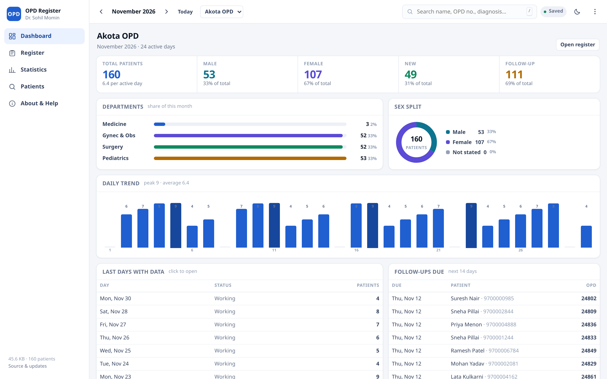

# OPD Register

[](https://drsamonline.github.io/app-opd-register/play/)


[](LICENSE)

**The daily OPD register, on one page, at typing speed — offline, no account, no server.**

Every day of the month is laid out and ready to type into. Counts, department splits and
the daily trend update as you write. Print the register for the file, export a day-wise
sheet to Excel, and keep several OPD centres apart in the same app. All of it lives in the
browser on your device; the page makes no network request at all.

| | |
|---|---|
| **Landing page** | https://drsamonline.github.io/app-opd-register/ |
| **Live app** | https://drsamonline.github.io/app-opd-register/play/ |
| **Demo** (sample month, memory only) | https://drsamonline.github.io/app-opd-register/play/index.html?demo=1 |
| **Single HTML file** | [`dist/opd-register.html`](dist/opd-register.html) — ~130 KB, opens from a USB stick |
| **Windows EXE / Android APK** | [releases](https://github.com/drsamonline/app-opd-register/releases/latest) |
| **Source** | https://github.com/drsamonline/app-opd-register |
| **Changelog** | [CHANGELOG.md](CHANGELOG.md) · [ROADMAP.md](ROADMAP.md) |
| **All projects** | https://drsamonline.github.io/ |

<!-- shot:start -->



<!-- shot:end -->

Screens at both widths: [`docs/assets/app-desktop.png`](docs/assets/app-desktop.png),
[`docs/assets/app-mobile.png`](docs/assets/app-mobile.png),
[`docs/assets/app-sheet.png`](docs/assets/app-sheet.png) (the phone editor),
[`docs/assets/app-history.png`](docs/assets/app-history.png) (history in the editor),
[`docs/assets/app-week.png`](docs/assets/app-week.png) (the week as seven columns),
[`docs/assets/app-slip.png`](docs/assets/app-slip.png) (the printed visit slip),
[`docs/assets/app-followups.png`](docs/assets/app-followups.png) (follow-ups due, by department),
[`docs/assets/app-search.png`](docs/assets/app-search.png) (the patient list and its sort),
[`docs/assets/app-columns.png`](docs/assets/app-columns.png) (Treatment-before-Diagnosis),
[`docs/assets/app-notice.png`](docs/assets/app-notice.png) (the one-time offer),
[`docs/assets/app-lock.png`](docs/assets/app-lock.png) (the lock screen),
[`docs/assets/app-lock-on.png`](docs/assets/app-lock-on.png) (the lock panel when on),
[`docs/assets/app-year.png`](docs/assets/app-year.png) (the year on one screen),
[`docs/assets/app-import.png`](docs/assets/app-import.png) (import: merge or replace),
[`docs/assets/app-conflict.png`](docs/assets/app-conflict.png) (what differs, and which side wins),
[`docs/assets/app-csv.png`](docs/assets/app-csv.png) (the spreadsheet column mapper),
[`docs/assets/app-settings.png`](docs/assets/app-settings.png) (display, lock, storage),
[`docs/assets/app-digest.png`](docs/assets/app-digest.png) (the printable digest) and
[`docs/assets/app-stats.png`](docs/assets/app-stats.png). Badges are drawn locally by
`scripts/badges.py`; the icon set by `scripts/icons.py`. Nothing here is fetched from a
badge service, because an offline-first app should not need the internet to describe itself.

## Run it

`docs/play/index.html` is the whole app. No build step, no install, no dependencies.

```
node tests/self-tests.js     # 139 checks, no browser needed (166 more run in a real browser)
python3 scripts/build.py     # the single-file build -> dist/opd-register.html
python3 scripts/badges.py    # the README badges
```

Append `?demo=1` for a generated month — real screens, real arithmetic, held in memory so
nothing is written to your device.

## What is in it

| View | What it does |
|---|---|
| **Dashboard** | Five KPIs (total, male, female, new, follow-up) with share-of-total; department bars; sex donut; a bar per day of the month; the last days with data (click to open); **follow-ups due in the next 14 days**, with the mobile number; a short "reading" panel — busiest day, new-vs-follow-up, working days with no entry, female share, gyn share. |
| **Register** | The month calendar with day statuses and per-day counts; then one section per day: status dropdown, free-text note, patient count, add-row, print-day and clear-day. **Month or week scope** — the week as seven columns you can compare, with a weekly total —
a **row filter** across the visible days (or **inside one day**), and a **range of days** marked in one go. Print
prints whatever is on screen: the month, or the week on one A4. On a desktop a sticky, column-aligned grid; on a phone a card per patient and a full-screen editor. |
| **Statistics** | Day-wise, month-wise or any date range, with 17 selectable columns (summary, departments, sex-within-department, activity). **Year view** — twelve months, a bar each, the annual totals and a *vs target* column on one
screen (it prints too). Print, Excel (.xls), CSV — and a **one-page digest** per month: totals, departments, every day in two columns, every week, a note on entries missing a diagnosis, and a signature line. |
| **Patients** | Ranked substring search over every month — name, OPD no., age, department, diagnosis, treatment, address — optionally across all locations, sorted newest / oldest / name / OPD. A hit opens that patient in the editor. |
| **About & help** | Storage used, patient and month counts, locations, backup and restore, keyboard reference, the counting rules, privacy and licence. |

Open a patient and the editor leads with **their previous visits** — date, department,
diagnosis, prescription, how long ago the last one was, and one button to copy that
prescription into today's row. **Print slip** turns those visits into half a page for the
file or the patient. A row can also repeat the last prescription with one click. Clicking
a row number opens it; the OPD field offers the **next number in your series** (offered, never
applied) and the department field offers the departments this location actually uses.

A patient entered on the wrong day can be **dragged** to the right one by its row number.
The register's **column order** is a setting (Treatment first, Name first, or default), the
dashboard can draw a **daily target** across the trend, and the reading panel counts rows
saved **without a diagnosis** — tap it to see only those days. The patient list exports to
CSV as it stands on screen, filtered and sorted.

Each patient row also carries a **mobile number** and a **follow-up date** — neither of them
makes a row a patient, so a stray date can never inflate a total. Rows duplicate with
**Ctrl+D** for the next member of the same family, `01/01/1990` typed into Age becomes 35
years, the department field offers the departments this location actually uses, a **range of
days** can be marked holiday in one go (and undone), **one day** can be printed on its own,
and ages read the way they are said: `8 mo`, not `0`.

Smaller things that earn their place: automatic OPD autofill for returning patients, recent
patient chips, undo on delete (row, patient, whole day) and on import, dark mode, a save
indicator, a storage-full fallback that prunes empty days rather than losing the entry,
install-as-app, and a single-file build for a USB stick.

## The counting rules, written down

A report nobody can explain is worse than no report, so the rules are in the app (About &
help) and here:

- **A row is a patient** when any of OPD no., department, name, age, address, diagnosis or
  treatment is filled. A half-typed row is still saved — nothing is ever thrown away for
  being incomplete.
- **Gynecology is female-only.** Any department containing *gyn*, *obs* or *obstet* is
  counted as female whatever the sex field says, and is counted once — not twice.
- **Under 15 also counts as Pediatrics.** A child entered under Medicine appears in both
  the Medicine and Pediatrics buckets. Age accepts `5`, `5y`, `1.5`, `6 mo`, `3 days`.
- **Day status is a label, not a filter.** Holiday, non-working and no-activity days are
  excluded from "per active day" averages, but their patients still count in the totals.

## Keyboard

`/` search · `N` new patient · `Ctrl`+`D` duplicate · `T` today · `D` dark mode · `1`–`5` sections ·
`Alt`+`←`/`→` month · `Enter` next row (adds one on the last row) · `Ctrl`+`Enter` add row ·
`↑`/`↓` move within a column · `Esc` close.

## Your data

**IndexedDB** holds every location and every month, in one record. A v2 register saved in
`localStorage` is migrated in on first open, and a browser without IndexedDB falls back to
`localStorage` automatically — the engine in use is shown in *About & help → This device*.

No account, no analytics, no cookie, no network call. Clearing site data erases it, so
**export a backup weekly** — the file carries a SHA-256 of its own contents, so a truncated
one is refused instead of half-imported. Importing shows a **preview first**: what the file
holds, what merging would add, top up or skip, and **which patients differ** — with the
choice of keeping what is here or taking the file's version. **Merge** fills empty fields of
a patient who is already here and never overwrites a filled one; **Replace** puts the file in
place of everything. Both are undoable, both say what they did, and the patients a merge
brought in can be found again from one button in *Patients*.

**Import a spreadsheet.** A CSV gets a **column mapper**: the header is guessed, you correct
it, rows without a date go to a day you choose, and the same preview follows. Quoted commas,
CRLF and `dd/mm/yyyy` all survive.
The file format is plain JSON and is compatible with the earlier v2 release.

**Optional passphrase lock — offered once, never nagged.** On first open the app asks
whether to protect the register, with *Turn it on* and *Not now* side by side. Declining is
remembered on that device and changes nothing else; the offer never comes back on its own,
and the way to change your mind is always in the ⋯ menu (*Lock & privacy*) and in
*About & help → Lock*. Forgot the passphrase? The lock screen offers to start again from a
backup file, and says plainly that the encrypted register is deleted if you do.

**Auto-lock** closes it again: *About & help → Lock → Lock automatically when idle* (never,
1, 5, 10 or 30 minutes) drops the key from memory and shows the lock screen. **An encrypted
backup** can be downloaded from the same panel — it is the ciphertext, so it is useless
without the passphrase and can be restored on another machine, plain backup or encrypted.

Turning the lock on encrypts the whole register with
AES-GCM-256, keyed from your passphrase through PBKDF2-HMAC-SHA256 (310,000 iterations, a
random 16-byte salt). The plain copy is deleted only after the encrypted write succeeds, and
the key is dropped from memory when you lock. A lost passphrase means a lost register — there
is no recovery, by design, because a recovery path would be a second way in.

## Layout

```
docs/index.html          the landing page — its own design, not the app's
docs/play/               the app: index.html, assets/, sw.js, manifest, icons/
docs/play/assets/        app.css · storage.js · lock.js · store.js · register.js · dashboard.js · stats.js · search.js · app.js
docs/shot.png            the screenshot the pipeline captures
docs/assets/             screenshots and the generated badges
dist/opd-register.html   the single-file build (generated)
scripts/build.py         inlines css + js into the single file
scripts/badges.py        draws docs/assets/badge-*.svg
scripts/icons.py         renders the PWA icon set from icon.svg
tests/self-tests.js      139 checks over the real source, no browser
```

The app is six classic scripts in one namespace, not ES modules — so it also runs from
`file://` inside a WebView and from the EXE's bundled server without a build step.

## Builds

One push to `main` builds the portable EXE and the APK, publishes the rolling `app-latest`
release and deploys the demo to Pages, all from the same commit — so the live demo and the
released binary can never disagree. The pipeline lives in the public
[`app-builder`](https://github.com/drsamonline/app-builder) kit; this repo only calls it.

## Support


Free, offline, accountless — and staying that way. If it earned its keep:

| | |
|---|---|
| UPI (India) | `drsohilboi@ybl` — payee Dr. Sohil Momin, open amount |
| GitHub Sponsors | [github.com/sponsors/drsamonline](https://github.com/sponsors/drsamonline) |
| Ko-fi | [ko-fi.com/matneo](https://ko-fi.com/matneo) |
| PayPal | [paypal.me/drsohilmomin](https://paypal.me/drsohilmomin?locale.x=en_GB&country.x=IN) |
| My books | [Amazon author store](https://www.amazon.com/stores/author/B08ZT331LY/allbooks?ccs_id=aed72b9f-71d9-41dc-adee-e9368a317acc) |
| More apps | [drsamonline.github.io](https://drsamonline.github.io/) |
| Email | [sohilmomin2000@gmail.com](mailto:sohilmomin2000@gmail.com) |

Nothing is gated behind it: no accounts, no tracking, no network requests.

## Attribution

- **Licence text** — [PolyForm Project](https://polyformproject.org/licenses/noncommercial/1.0.0), PolyForm Noncommercial 1.0.0.
- **Icons** — drawn for this app as inline SVG paths and one `icon.svg`. No icon font, no
  Font Awesome, no Lucide dependency.
- **Fonts** — the system UI font stack. Nothing is downloaded.
- **Charts** — a donut of two `<circle>` elements and a row of `<div>` bars. No chart library.
- **Patient data in the screenshots** — generated by the app's own `?demo=1` month; the
  names are invented.
- **Clinical conventions** (gynecology as female-only, under-15 as pediatrics) follow how the
  paper OPD register in an Indian district hospital is tallied; they are documented in the
  app so a reader can disagree with them explicitly.

## Licence

PolyForm Noncommercial 1.0.0 — see [`LICENSE`](LICENSE). © 2026 Dr Sohil Momin.
